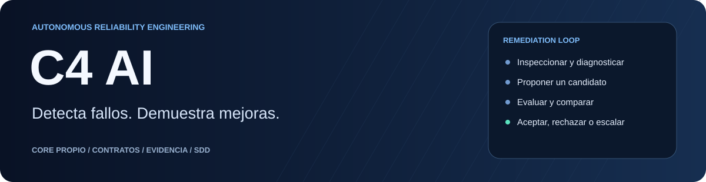
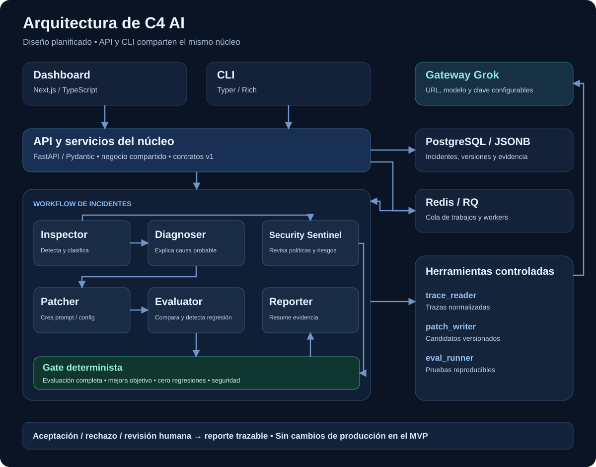
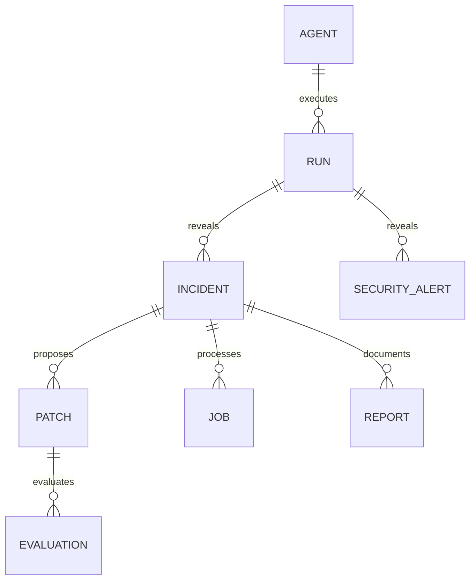

<p align="center"></p>

# C4 AI

**Un ingeniero de confiabilidad para agentes de IA, con correcciones respaldadas por evidencia.**

C4 AI recibe una ejecución fallida, investiga su causa, propone un candidato de prompt o configuración y compara su comportamiento contra el baseline. El resultado es una decisión trazable: aceptar, rechazar o solicitar revisión humana.

**Estado actual (2026-10-17):** CLI end to end con Grok verificada sobre seis casos sintéticos: baseline 5/6 → candidato 6/6, cero regresiones y controles obligatorios aprobados. Contratos Pydantic disponibles y dashboard de Santiago con mocks integrado por PR18. API, PostgreSQL y workers siguen planificados; el dashboard todavía no muestra esta evidencia real.

[Abrir consola interactiva](docs/arquitectura/CLI.md) · [Evidencia y rúbrica pendiente](docs/producto/ENTREGA_S1.md) · [Dashboard local](apps/dashboard/README.md)

**Acceso:** repositorio y tablero privados para Deimer y Santiago. Trabajo en equipo autorizado por la organización, confirmado por Deimer. La publicación se decidirá posteriormente.

[Documentación](docs/README.md) · [Especificaciones SDD](docs/specs/README.md) · [Contratos](docs/arquitectura/API.md) · [Kanban](https://github.com/users/DEIMER-PY/projects/1/views/2) · [Tareas](https://github.com/DEIMER-PY/c4-ai/issues) · [Onboarding](docs/equipo/ONBOARDING_SANTIAGO.md)

[Probar las integraciones en orden: Groq → Grok → evidencia](docs/equipo/PRUEBAS_INTEGRACIONES.md).

## Consola de C4 AI

```powershell
uv sync --locked
uv run --locked c4 tui
# Para evaluar Qwen con Groq:
uv run --locked c4 --target-provider groq tui
```

La consola muestra neurona Unicode ramificada magenta/cian, con núcleo luminoso y axón segmentado, proveedor/modelo, comandos con Tab, historial en memoria y evidencia real. Abrirla no consume solicitudes. Usa `/help`, `/doctor`, `/runs`, `/report last` y `/demo`; solo los comandos de ejecución o --probe llaman a los proveedores. En una terminal interactiva, `c4` sin argumentos también abre la consola.

Grok diagnostica y propone candidatos; el target puede ser Grok o Groq/Qwen. Cada comparación mantiene el mismo modelo, esquema y dataset. La prueba real Qwen se rechazó por una regresión: un ciclo terminado no implica candidato aceptado. [Configuración y evidencia Groq](docs/referencias/GROQ.md). [Rúbricas del equipo](docs/equipo/RUBRICAS.md).

Jev de TypeSafe queda como experimento de triage probabilístico; todavía no está integrado ni hay rapidez verificada en C4. [Propuesta, acceso y aceptación](docs/producto/JEV.md).

## El problema que resolvemos

Los equipos que operan agentes necesitan revisar trazas, identificar por qué falló una herramienta o una respuesta, ajustar instrucciones y repetir pruebas. Una corrección aparentemente útil puede introducir una regresión o violar una política.

C4 AI automatizará ese ciclo para desarrolladores y equipos de producto, calidad y operaciones. Su enfoque inicial es **confiabilidad y seguridad aplicada a agentes**, con medición de costo y rendimiento.

## Alcance del primer producto

El agente objetivo inicial es de **soporte y reembolsos**, con una política y un catálogo de herramientas controlados.

```text
Ejecución y traza
       ↓
Detectar y clasificar el incidente
       ↓
Diagnosticar con evidencia
       ↓
Crear un candidato versionado
       ↓
Evaluar baseline y candidato sobre el mismo dataset
       ↓
Aceptar / rechazar / solicitar revisión
       ↓
Registrar reporte, costo conocido y resultados por caso
```

Un candidato se acepta solo con evaluación completa, mejora del caso objetivo, cero regresiones en casos que pasaban y controles obligatorios de seguridad aprobados. Evidencia incompleta exige revisión humana.

El MVP limita cambios a prompts y configuración de agentes de prueba. Aplicar cambios automáticamente a producción, ejecutar código arbitrario generado y entrenar modelos quedan fuera de esta fase.

## Arquitectura



La **API y la CLI comparten servicios de negocio**. El workflow procesa incidentes con herramientas controladas; PostgreSQL conserva evidencia y versiones, mientras Redis/RQ administra los trabajos. El dashboard consulta esos resultados.

| Módulo | Responsabilidad | Resultado |
|---|---|---|
| Inspector | Leer trazas y detectar el fallo | Hallazgos e incidente |
| Diagnoser | Investigar causas probables | Hipótesis y referencias |
| Patcher | Preparar un cambio declarativo | Candidato y diff |
| Evaluator | Ejecutar baseline y candidato | Resultados y regresiones |
| Security Sentinel | Revisar políticas, inyección y herramientas | Alertas y bloqueo de controles |
| Reporter | Explicar la decisión final | Reporte con evidencia |

Los seis módulos no implican seis procesos ni seis llamadas obligatorias al modelo. Evaluación y aceptación usan comprobaciones verificables; el diagnóstico del LLM no sustituye el gate.

[Arquitectura completa](docs/arquitectura/ARQUITECTURA.md) · [Decisión del core propio](docs/decisiones/ADR-001.md) · [Seguridad](docs/arquitectura/SEGURIDAD.md)

## Datos y contratos



| Contrato | Contenido esencial |
|---|---|
| Agent / Run | Versión, entradas, salidas, trazas, latencia y consumo |
| Incident | Categoría, severidad, diagnóstico y estado |
| Patch | Baseline, candidato, diff y decisión |
| Evaluation | Dataset/version, before/after y casos con regresión |
| Job / Report | Etapa, error, intentos, decisión y referencias |

Los contratos v1 se documentan antes de implementar endpoints. Un trabajo `queued` no es un análisis exitoso y `cost_usd: null` significa costo desconocido.

[API y CLI previstas](docs/arquitectura/API.md) · [Modelo de datos](docs/arquitectura/DATOS.md) · [JSON Schema](examples/contracts/schemas.json) · [Mock de respuestas](examples/contracts/api-responses.json)

## Tecnologías

| SVG | Tecnología | Uso previsto |
|:---:|---|---|
|  | Python 3.12 | Runtime, agentes, servicios y evaluaciones |
|  | FastAPI | API y control de trabajos |
|  | Pydantic | Entradas y salidas tipadas |
|  | SQLAlchemy / Alembic | Persistencia y migraciones |
|  | uv | Dependencias Python y lockfile |
|  | TypeScript | Contratos y frontend tipado |
|  | Next.js | Dashboard propio |
|  | Tailwind / shadcn/ui | Estilos y componentes |
|  | pnpm | Dependencias del dashboard |
|  | PostgreSQL / JSONB | Entidades, trazas y evidencia |
|  | Redis / RQ | Cola y workers |
|  | Docker Compose | Entorno local reproducible |
|  | Obsidian | Lectura y edición de documentación |

Herramientas adicionales: **Typer/Rich** para CLI, **httpx** para HTTP y **Recharts** para comparaciones. Grok se integrará mediante el gateway del reto, con URL, modelo y credencial configurables.

Las versiones exactas de dependencias se fijarán al implementar. Los recursos SVG son locales y tienen [procedencia y atribución](docs/assets/README.md).

## Estructura del repositorio

```text
c4-ai/
├── README.md / AGENTS.md / CLAUDE.md
├── CONTRIBUTING.md / SECURITY.md
├── apps/
│   ├── api/                    FastAPI
│   ├── cli/                    Typer / Rich
│   └── dashboard/              Next.js
├── c4/
│   ├── agents/                 Roles especializados
│   ├── workflows/              Etapas y decisiones
│   ├── tools/                  Integraciones y herramientas
│   ├── schemas/                Contratos Pydantic previstos
│   ├── services/               Negocio compartido
│   └── db/                     SQLAlchemy / Alembic previstos
├── docs/
│   ├── producto/               PRD, dashboard, demo, roadmap
│   ├── arquitectura/           Sistema, datos, API, evals, seguridad
│   ├── equipo/                 Roles, estado, Git, SDD, onboarding
│   ├── specs/                  Spec / plan / tasks por feature
│   ├── assets/                 Diagramas e iconos SVG
│   ├── decisiones/             ADR
│   ├── bitacora/               Evidencia y acuerdos
│   └── referencias/            Fuentes y verificaciones
├── examples/contracts/         Esquemas y fixtures sintéticos
├── datasets/sample/            Casos de soporte/reembolsos
├── tests/                      Pruebas previstas por nivel
├── scripts/                    Validadores disponibles
├── .githooks/                  Validación local de commits
└── .github/                    Plantillas, ownership y CI
```

apps/dashboard contiene la interfaz de demostración; c4/cli.py expone la CLI instalable y c4/services/reliability.py implementa el ciclo compartible con la futura API. Persistencia actual: evidencia local por sesión, sin PostgreSQL todavía.

## Metodología SDD

Trabajamos con **Spec-Driven Development**:

```text
spec.md → aclaraciones → plan.md → tasks.md → implementación → evidencia
```

Cada feature define requisitos identificados, aceptación verificable, contratos y dependencias antes de implementar. Codex y Claude leen la misma especificación; los cambios de alcance actualizan primero esos artefactos.

[Guía SDD](docs/equipo/SDD.md) · [Marco del MVP](docs/specs/001-project-foundation/spec.md) · [Plantillas](docs/specs/templates/spec.md)

## Equipo y trabajo paralelo

| Responsable | Entregables principales |
|---|---|
| Deimer / `DEIMER-PY` + Codex | Backend, agentes, API, CLI, persistencia, evals y seguridad |
| Santiago / `santiagosanabria-1` + Claude | Dashboard, UX, integración y demo visual |
| Ambos | Arquitectura, dataset, contratos y aceptación final |

Deimer inicia con C4-001 y C4-002. Santiago comienza con C4-011 y C4-004; puede construir la interfaz con los mocks mientras el backend avanza.

GitHub conserva tareas, PR y decisiones. Slack coordina mediante un hilo por tarea. Obsidian abre la documentación Markdown compartida por Git. No existe sincronización automática de los chats o memorias privadas de los agentes.

[Backlog](docs/equipo/BACKLOG.md) · [Enlaces y hilos](docs/equipo/ENLACES.md) · [Reglas compartidas](AGENTS.md) · [Entrada para Claude](CLAUDE.md)

[Plan de Santiago](docs/equipo/PLAN_SANTIAGO.md) · [Prompt inicial de Claude](docs/equipo/PROMPT_CLAUDE.md) · [Guía Obsidian](docs/equipo/OBSIDIAN.md)

## Flujo Git y commits

La rama predeterminada es **`develop`**. Cada feature usa una rama independiente y un PR hacia `develop`.

```text
codex/feat-c4-002-contracts
santiago/feat-c4-004-dashboard

feat(api): ✨ registrar ejecuciones
fix(evals): 🐛 rechazar candidatos con regresiones
docs(readme): 📝 documentar arquitectura
```

El hook local y la CI validan commits convencionales con emoji. Los emojis se reservan a los mensajes de commit; las rutas, identificadores y navegación permanecen estables.

[Flujo Git](docs/equipo/GIT_WORKFLOW.md) · [Contribución](CONTRIBUTING.md)

## Empezar ahora

```bash
git clone https://github.com/DEIMER-PY/c4-ai.git
cd c4-ai
git switch develop
python scripts/verify_docs.py
git config --local core.hooksPath .githooks
```

Para leer todo el contexto en Obsidian, abrir la carpeta del repositorio como bóveda permite navegar también a `AGENTS.md` y `CLAUDE.md`; `docs/` concentra la documentación.

Preparar los ajustes locales: `python scripts/setup_obsidian.py`. Cada persona abre su clon como bóveda; Git comparte la documentación. La configuración privada `.obsidian/` no se publica.

Ejecutar el ciclo local con `uv sync --locked` y `uv run --locked c4 demo`, después de configurar `.env` local. Consultar `uv run --locked c4 --help`. [Instalación y requisitos](docs/arquitectura/INSTALACION.md).

El backend se verifica con Python 3.12 y uv: `uv run --locked python -m unittest discover -s tests/unit -p 'test_*.py' -v`. En apps/dashboard: `pnpm install --frozen-lockfile`, `pnpm build`, `pnpm start`. El servidor local muestra fixtures con etiqueta Demo.

## Evaluación, seguridad y roadmap

| Fase | Evidencia esperada |
|---|---|
| Preparación | Documentación, contratos, SDD, backlog y onboarding |
| Primer flujo | Incidente → candidato → evidencia mediante API/CLI |
| Herramientas y dashboard | Tres herramientas reales, errores y demo |
| Dataset y métricas | 30+ casos, before/after, regresiones y costo por tarea |
| Escala | 1.000 trabajos únicos y prueba real de 12 horas |

Los hitos del reto recuperados del chat deben contrastarse con los requisitos oficiales vigentes. Los mocks no cuentan como ejecución real.

[Evaluaciones](docs/arquitectura/EVALUACIONES.md) · [Controles de seguridad](docs/arquitectura/SEGURIDAD.md) · [Roadmap](docs/producto/ROADMAP.md) · [Demo](docs/producto/DEMO.md) · [Estado actual](docs/equipo/ESTADO.md)

Credenciales quedan fuera de Git, incluso en el repositorio privado. La licencia del código está pendiente de decisión; los iconos conservan su licencia y atribución propias.
