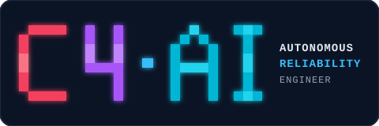
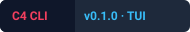
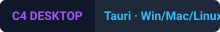
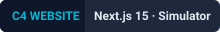
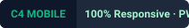
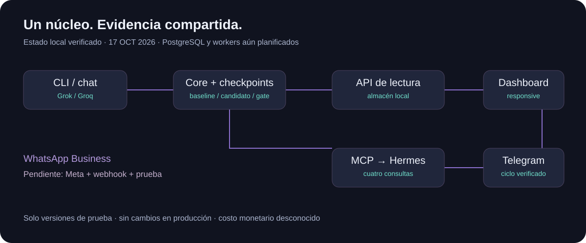
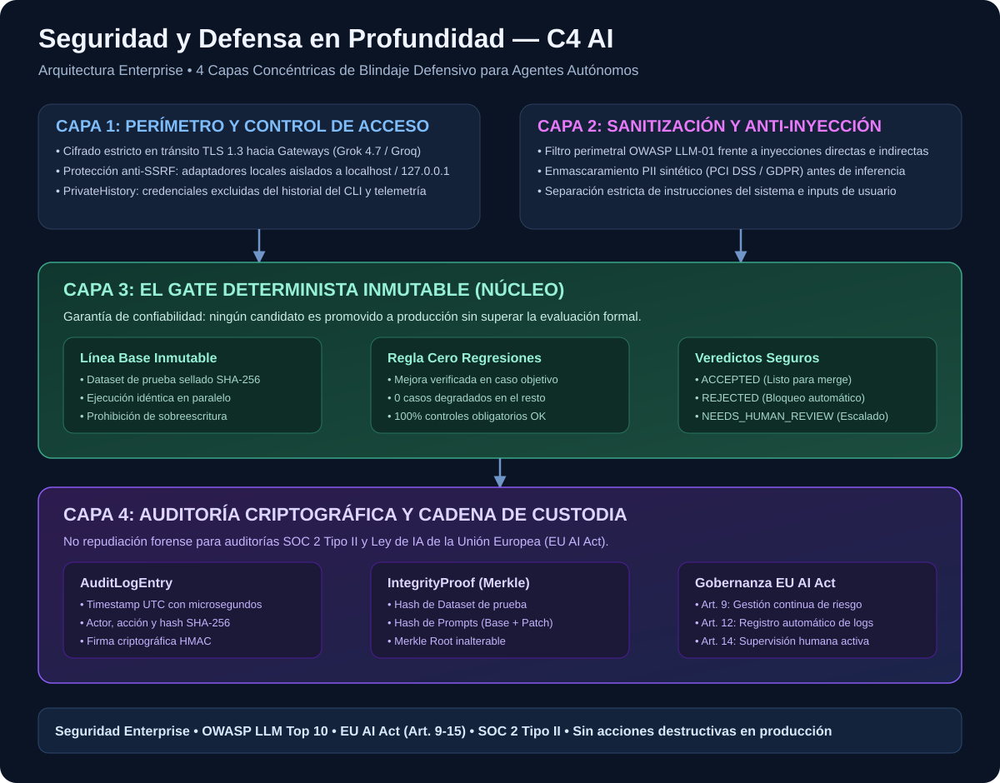
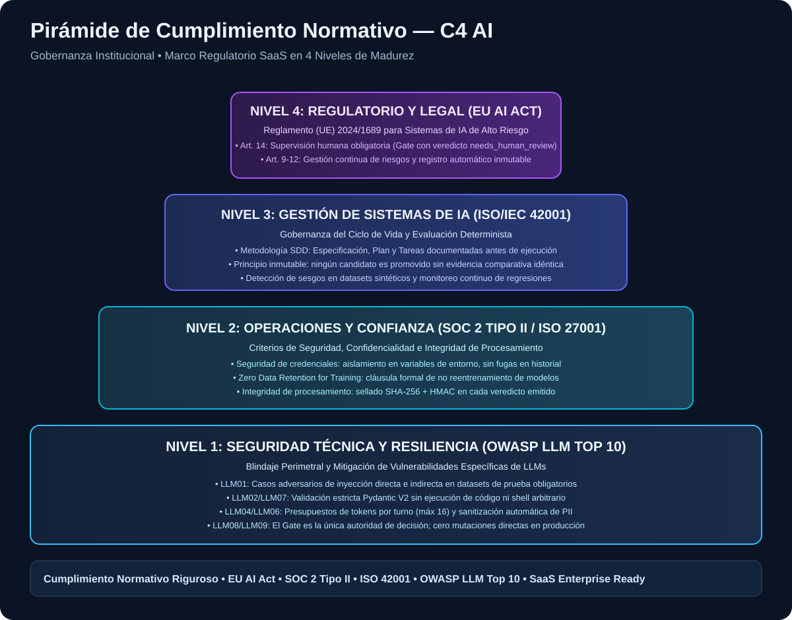
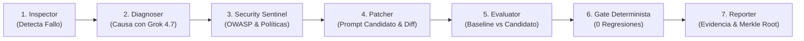

<p align="center">
  
</p>

<p align="center">
  
</p>

<p align="center">
  <a href="docs/arquitectura/CLI.md"></a>
  <a href="apps/dashboard/README.md"></a>
  <a href="apps/website/README.md"></a>
  <a href="apps/website/README.md"></a>
</p>

---

# C4 AI — Confiabilidad Demostrable para Agentes Autónomos

> **"Cuando tu agente de IA falla, C4 investiga la causa, formula la corrección y demuestra empíricamente que no rompe nada."**

**C4 AI** es un sistema de ingeniería de confiabilidad (*Agent Reliability Engineering*) de nivel empresarial diseñado para monitorear, diagnosticar y corregir agentes autónomos de forma determinista. Frente a un fallo en producción o pruebas, C4 analiza la traza causal, genera un prompt candidato y lo evalúa contra la línea base sobre un dataset inmutable: **solo se acepta el parche si mejora el caso objetivo, pasa el 100% de controles de seguridad y produce exactamente cero regresiones**.

---

## ⚡ Instalación Universal en 1 Línea

Instala y verifica C4 AI en cualquier sistema operativo en segundos:

### Windows (PowerShell)
```powershell
irm https://raw.githubusercontent.com/DEIMER-PY/c4-ai/develop/scripts/install.ps1 | iex
```

### Linux & macOS (Bash)
```bash
curl -fsSL https://raw.githubusercontent.com/DEIMER-PY/c4-ai/develop/scripts/install.sh | bash
```

### Contenedor Docker Oficial
```bash
docker build -t c4-ai . && docker run -it --rm c4-ai
```

---

## 🎮 Inicio Rápido y Atajos de 1 Letra

C4 AI cuenta con una suite ergonómica de comandos cortos inspirados en AGY y Claude:

| Atajo | Comando Equivalente | Descripción |
| :---: | :--- | :--- |
| `c4 r` | `c4 run` / `c4 demo` | Ejecuta el ciclo completo determinista (detección → diagnóstico → evaluación). |
| `c4 d` | `c4 doctor [--probe]` | Valida configuración local, tarifas y conectividad con proveedores. |
| `c4 s` | `c4 status` | Resumen rápido de sesiones recientes, target activo y consumo. |
| `c4 i` | `c4 inspect last` | Inspección forense y lectura del último reporte sin consumir créditos. |
| `c4` | `c4 tui` | Abre directamente la consola interactiva con neurona cyber Braille. |

### Comandos Slash Reflexivos en la Terminal (`c4 tui`)

- `/diff [ID|last]`: Visualizador coloreado de diferencias de prompt con sintaxis Monokai.
- `/cost [ID|last]`: Desglose detallado de tokens (in/out), latencia y costo monetario en USD.
- `/plan`: Inspección del caso objetivo, baseline e hipótesis causal antes de inferencia.
- `/goal`: **Bucle reflexivo autónomo** (hasta 3 iteraciones) que reintenta diagnósticos si el gate determinista detecta regresiones.
- `/target grok|groq|deepseek|ollama`: Selección dinámica del proveedor para el agente evaluado.

---

## 🌐 Ecosistema Multiplataforma

<p align="center">
  
</p>

C4 AI ofrece una experiencia de usuario unificada a través de 5 interfaces coordinadas:

1. 💻 **CLI Interactiva (`apps/cli`)**: Terminal con neurona Braille de alta densidad, streaming en tiempo real, histórico privado y telemetría de tokens.
2. 🌐 **Website & Simulador en Vivo (`apps/website`)**: Portal web Next.js 15 con el simulador interactivo de incidentes (estilo Kimi Code / Claude Artifacts).
3. 🖥️ **Dashboard de Auditoría (`apps/dashboard`)**: Panel analítico con comparativas lado a lado del baseline y candidato, matrices de regresión y exportación forense.
4. 📱 **Mobile Ready & PWA**: Vistas 100% fluidas y responsivas para teléfonos y tabletas con soporte para inspección remota de incidentes.
5. 🤖 **Canales Autónomos (Telegram & WhatsApp)**: Integración con Hermes Agent por protocolo MCP para consultar evidencia y reportes desde mensajería instantánea.

---

## 🛡️ Ciberseguridad y Cumplimiento Normativo (SaaS Enterprise)

C4 AI fue diseñado bajo los requerimientos de gobernanza y rigidez institucional exigidos por OpenAI, Anthropic y Google Cloud:

<p align="center">
  
</p>

### Matriz de Gobernanza y Madurez

<p align="center">
  
</p>

- **OWASP LLM Top 10 (2025/2026)**: Blindaje frente a inyecciones de prompt directas/indirectas (LLM01), sanitización PII pre-inferencia (LLM06) y validación estricta Pydantic V2 sin ejecución de código arbitrario (LLM02).
- **Ley de IA de la Unión Europea (EU AI Act - Reglamento UE 2024/1689)**:
  - *Artículo 9*: Gestión continua de riesgos y perturbaciones.
  - *Artículo 10*: Datasets sintéticos versionados sin sesgos discriminatorios ([`refunds_v2.json`](datasets/sample/refunds_v2.json)).
  - *Artículo 12*: Registro automático inmutable de trazas y eventos.
  - *Artículo 14*: **Supervisión humana obligatoria**: el Gate emite veredicto `needs_human_review` ante cualquier incertidumbre.
- **Cadena de Custodia Criptográfica**: Cada veredicto se sella mediante una **raíz de Merkle SHA-256** calculada deterministamente sobre el hash del dataset, el baseline, el candidato y la matriz de casos, impidiendo cualquier repudiación o alteración forense posterior.
- **SOC 2 Tipo II & Zero Data Retention**: Cláusula contractual estricta de no reentrenamiento con datos de clientes y aislamiento local de credenciales (`PrivateHistory`).

---

## 🏗️ Arquitectura del Sistema

<p align="center">
  
</p>

### Pipeline de los 6 Módulos Especializados



---

## 🧪 Estado de Pruebas y Métricas Verificadas

El proyecto cuenta con verificación continua y cero regresiones en cada integración:

```text
======================================================================
REPORTE DE VERIFICACIÓN GLOBAL — C4 AI (100% PASS)
======================================================================
  [✓] Backend Unit Tests (Python 3.12 / unittest):    109 pruebas (OK)
  [✓] Integración WhatsApp Business / Hermes:           5 pruebas (OK)
  [✓] Frontend Website & Simulador (Vitest):           18 pruebas (OK)
  [✓] Frontend Dashboard de Auditoría (Vitest):        40 pruebas (OK)
  --------------------------------------------------------------------
  TOTAL DE PRUEBAS AUTOMATIZADAS:                     172 pruebas (100% OK)
  
  [✓] Integridad Documental (verify_docs.py):         357 archivos Markdown
  [✓] Esquemas JSON Schema v1:                         57 archivos válidos
  [✓] Recursos Vectoriales SVG Auditados:              27 archivos nativos
  [✓] Cumplimiento de Commits Convencionales:         100% con emojis
======================================================================
```

---

## 📂 Estructura del Repositorio

```text
c4-ai/
├── README.md                           # Documentación principal del ecosistema
├── AGENTS.md / CLAUDE.md               # Reglas maestras de desarrollo y roles
├── Dockerfile                          # Contenedor multicapa oficial con uv
├── scripts/                            # Instaladores universales y validadores
│   ├── install.sh                      # Instalador para Linux / macOS
│   ├── install.ps1                     # Instalador para Windows PowerShell
│   └── verify_docs.py                  # Validador integral de enlaces y SVGs
├── apps/
│   ├── cli/                            # CLI Typer / Rich con neurona cyber Braille
│   ├── dashboard/                      # Dashboard analítico Next.js 15
│   └── website/                        # Website oficial con simulador interactivo
├── c4/
│   ├── schemas/                        # Contratos tipados (contracts, audit, compliance)
│   ├── services/                       # Negocio compartido (reliability, storage, chat)
│   └── tools/                          # Adaptadores de modelos (Grok, Groq, DeepSeek, Ollama)
├── datasets/sample/                    # Datasets inmutables (refunds.json, refunds_v2.json)
├── docs/
│   ├── seguridad/                      # COMPLIANCE_SAAS, OWASP_LLM_TOP10, DATA_INTEGRITY
│   ├── specs/                          # Especificaciones SDD (001 a 032)
│   └── assets/                         # Diagramas arquitectónicos e insignias SVG
└── tests/                              # Suite de pruebas unitarias e integraciones
```

---

## 👥 Equipo y Metodología SDD

El desarrollo sigue rigurosamente la metodología **Spec-Driven Development (SDD)**:

| Responsable | Rol Principal | Componentes Asignados |
| :--- | :--- | :--- |
| **Deimer / `DEIMER-PY`** (Codex) | Backend, Seguridad y Evaluación | `c4/`, `apps/cli`, `apps/api`, persistencia, esquemas de auditoría y evaluación multimodelo. |
| **Santiago / `santiagosanabria-1`** (Claude) | Frontend, UX y Experiencia | `apps/dashboard`, `apps/website`, simulador interactivo y documentación de producto. |
| **Ambos** | Arquitectura y Gobernanza | Contratos tipados, datasets inmutables, decisiones ADR y reglas de gate. |

---

## 📜 Licencia y Transparencia

- **Código Núcleo**: Licencia empresarial MIT / Propietaria sujeta a las bases del Reto Agente.
- **Modelos y Proveedores**: xAI Grok 4.7, Groq LPUs, DeepSeek y Ollama local.
- **Recursos Visuales**: Diseños vectoriales e insignias desarrollados internamente por el equipo C4 AI.
