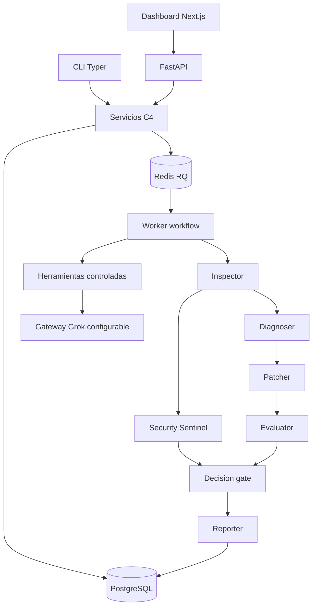

# Arquitectura lógica
Estado: planificada. Core propio; API y CLI son adaptadores del mismo núcleo.

## Módulos runtime
| Módulo | Entrada | Salida / responsabilidad |
|---|---|---|
| Inspector | Run + traza | Hallazgos y categoría de incidente |
| Diagnoser | Incidente + evidencia | Hipótesis, causa probable y referencias |
| Patcher | Diagnóstico + versión | Candidato de prompt/configuración y diff |
| Evaluator | Baseline + candidato + dataset | Resultados por caso y regresiones |
| Security Sentinel | Traza + candidato | Alertas y bloqueo de controles obligatorios |
| Reporter | Evidencia + decisión | Reporte legible y referencias |

Los módulos no necesitan ser seis procesos ni seis llamadas LLM por incidente. La evaluación y decisión deben basarse en comprobaciones, no en la opinión de un modelo.
Security Sentinel y diagnóstico pueden correr en paralelo tras inspección. Reporter espera evaluación y decisión.
## Flujo
Ingesta valida contrato → persiste run → crea incidente/job → worker analiza → candidato inmutable → evaluación baseline/candidato → decisión → reporte.
Aceptado solo si mejora el caso objetivo, no reduce pass rate total y no crea regresiones en casos que pasaban ni fallos obligatorios de seguridad. Evidencia incompleta implica needs_human_review.
## Recuperación
Job tiene etapas persistidas, lease y timeout. Reanudar una etapa requiere idempotencia y evidencia previa; nunca duplicar aplicación de un candidato.
Reintentar fallos transitorios del proveedor con límite; agotamiento/budget → fallo registrado.
No ejecutar conexiones empresariales ni modificaciones de producción en esta fase.
## Límites de carpetas
apps contiene adaptadores; c4/services negocio; workflows secuencias; agents roles; tools integraciones; schemas contratos; db almacenamiento.
RQ procesa incidentes independientes. El diseño debe evitar procesos hijos inseguros o redis como única fuente de evidencia.
