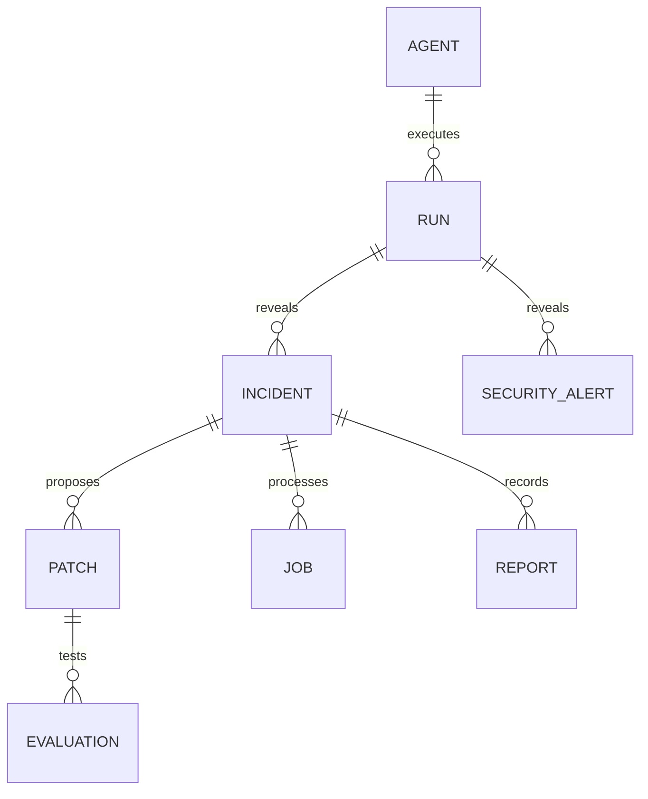

# Modelo de datos previsto
Estado: planificado; no hay migraciones aplicadas.
IDs opacos con prefijos legibles en ejemplos; implementación usará UUID con prefijo por entidad. Fechas ISO 8601 UTC; dashboard convierte a zona del usuario.
| Entidad | Campos esenciales | Relaciones |
|---|---|---|
| Agent | id, name, version, prompt_ref, config_ref, created_at | Una versión es inmutable; runs apuntan a una versión |
| Run | id, agent_id, status, input_payload, output_payload, trace, latency_ms, usage, created_at | Una ejecución del agente objetivo |
| Incident | id, run_id, category, severity, summary, root_cause, status | Una ejecución puede tener varios hallazgos |
| Patch | id, incident_id, baseline_agent_id, candidate_agent_id, patch_type, diff, rationale, approval_status | No sobrescribir baseline |
| Evaluation | id, patch_id, dataset_id, dataset_version, before, after, regressions, security_passed, status | Baseline/candidato sobre idéntico dataset |
| Job | id, incident_id, stage, status, attempts, error, updated_at | Trazabilidad de ejecución y recuperación |
| Report | id, incident_id, patch_id, evaluation_id, decision, evidence_refs | Sin decisión positiva sin evaluación completa |
| SecurityAlert | id, run_id, patch_id opcional, type, severity, evidence_refs | Hallazgos separados |

JSONB para payloads/trazas/resultados; campos indexables para IDs, estado y timestamps.
usage.cost_usd nullable: null = desconocido, nunca cero inventado. Conservar tokens/modelo y origen de tarifa cuando exista.
Distinguir trazas sintéticas de reales. Guardar hashes/versiones de dataset y evidencia; anonimizar antes de publicación.
Métricas de producto derivan de registros completos; incompletos no cuentan como éxito.
