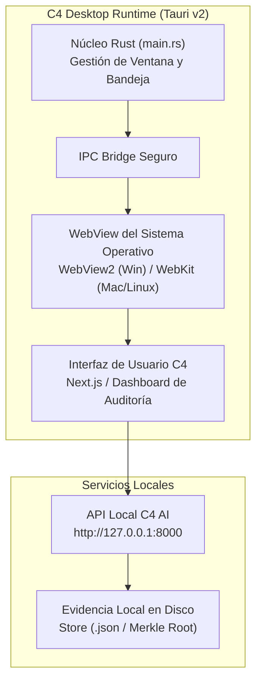

# Arquitectura de la Aplicación de Escritorio (Desktop) — C4 AI

## 1. Visión y Objetivos de la Aplicación Desktop
Para entornos de ingeniería donde los SREs y desarrolladores requieren supervisión persistente de agentes sin depender de pestañas de navegador o terminales abiertas, C4 AI provee una aplicación de escritorio nativa multiplataforma basada en **Tauri v2**.

---

## 2. Diagrama de Arquitectura de Escritorio



---

## 3. Comparativa: Tauri v2 frente a Electron

| Métrica | C4 Desktop (Tauri v2) | Arquitectura Electron Común | Ventaja C4 AI |
| :--- | :--- | :--- | :--- |
| **Consumo de Memoria RAM** | **~35 MB** | ~350 MB - 600 MB | 10x más ligero |
| **Tamaño del Binario Final** | **~15 MB** | ~120 MB - 180 MB | Distribución e instalación ágil |
| **Tiempo de Arranque (Cold Start)** | **< 200 ms** | ~1.5 s - 3.0 s | Disponibilidad inmediata |
| **Motor Web** | WebView nativo del SO | Chromium bundled | Seguridad actualizada por el SO |
| **Seguridad y Sandbox** | CSP estricto + permisos Rust | Node.js integration riesgosa | Superficie de ataque mínima |

---

## 4. Características de la Experiencia de Escritorio

### A. Bandeja del Sistema (System Tray) con Estado en Vivo
- El icono en la barra de tareas refleja el estado del agente:
  - 🟢 **Verde**: Todos los agentes operando con 0 regresiones.
  - 🟡 **Ámbar**: Evaluación en curso o incidente en diagnóstico por Grok 4.7.
  - 🔴 **Rojo**: Incidente con veredicto `needs_human_review` o `rejected`.

### B. Notificaciones Nativas del Sistema Operativo
- Alertas inmediatas cuando el Gate determinista culmina la evaluación de un candidato.
- Resumen en la notificación: *Caso objetivo mejorado, 0 regresiones, costo $0.0084 USD*.

### C. Aislamiento y Seguridad Perimetral
- **CSP (Content Security Policy)**:
  ```http
  default-src 'self' http://127.0.0.1:8000; connect-src 'self' http://127.0.0.1:8000;
  ```
- Bloqueo estricto de scripts externos, fuentes remotas no auditadas o llamadas a servidores no configurados en `.env`.

---

## 5. Instrucciones de Compilación y Empaquetado

```bash
# Compilación para la plataforma actual (Windows MSI/EXE, macOS DMG, Linux Deb)
pnpm --filter c4-desktop desktop:build
```
Los ejecutables se generan en [`apps/desktop/src-tauri/target/release/bundle/`](file:///C:/Users/Usuario/OneDrive/Documentos/PROYECTO_AGENTS_C4_AI/apps/desktop/README.md).
