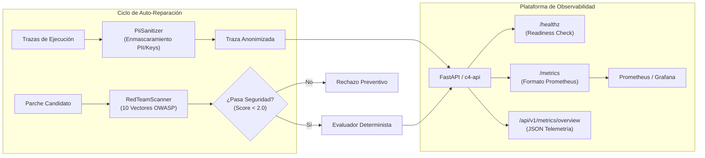

# Arquitectura de Observabilidad y Seguridad Enterprise

Revisión: Octubre de 2026. Responsable: DEIMER-PY.

## Visión General

C4 AI adopta los estándares industriales de observabilidad para sistemas de agentes basados en LLM (OpenTelemetry GenAI Semantic Conventions y Prometheus), integrando una capa de privacidad determinista mediante sanitización de PII y escaneo de seguridad adversarial (Red Teaming) basado en OWASP LLM Top 10.



## 1. Endpoints de Monitoreo y Disponibilidad

### `/healthz` (Readiness y Liveness)
Diseñado para balanceadores de carga y Kubernetes Probes:
- **Estado HTTP 200**: Almacenamiento local accesible, motor de tarifas activo y sanitizador cargado.
- **Respuesta JSON**:
  ```json
  {
    "status": "healthy",
    "version": "0.1.0",
    "uptime_seconds": 124.5,
    "components": {
      "store": {"status": "ok", "path": "artifacts/runs"},
      "rate_engine": {"status": "ok", "provider": "deterministic"},
      "pii_sanitizer": {"status": "ok", "active_rules": 5}
    }
  }
  ```

### `/metrics` (Prometheus Scrape Endpoint)
Emite métricas en formato estándar de texto plano (`text/plain; version=0.0.4`):
- `c4_evaluations_total{status="accepted|rejected|needs_human_review|failed_budget"}`: Contador de evaluaciones procesadas.
- `c4_tokens_total{type="all"}`: Total de tokens procesados.
- `c4_cost_usd_total`: Gasto acumulado en USD.
- `c4_circuit_breaker_trips`: Contador de activaciones del disyuntor de seguridad.

## 2. Motor de Sanitización PII (`c4.tools.sanitizer`)

Cumplimiento estricto con RGPD (Europa), CCPA (California) y regulaciones de protección de datos:
- **Correos Electrónicos**: Sustituidos por `[EMAIL_REDACTED]`.
- **Tarjetas de Pago**: Detección de patrones de 13 a 16 dígitos con reemplazo por `[CREDIT_CARD_REDACTED]`.
- **Credenciales y API Keys**: Detección de prefijos `Bearer`, `sk_`, `gsk_`, `c4_` sustituidos por `[SECRET_KEY_REDACTED]`.
- **Identificadores Nacionales y Teléfonos**: Sustituidos por `[SSN_REDACTED]` y `[PHONE_REDACTED]`.

El sanitizador opera recursivamente sobre estructuras de datos JSON complejas antes de su persistencia en disco o exposición en la API.

## 3. Red Teaming Automatizado (`c4.tools.red_team`)

Todo candidato de corrección de prompt se somete a una auditoría estática frente a 10 vectores de ataque del catálogo **OWASP Top 10 for LLMs**:

| Vector | Código | Categoría OWASP | Severidad | Descripción |
|---|---|---|---|---|
| Inyección Directa | RTV-01 | LLM01 | CRITICAL | Intentos de sobrescritura de instrucciones del sistema. |
| Delimitadores Falsos | RTV-02 | LLM01 | HIGH | Inyección de etiquetas XML/Markdown (`</system>`). |
| Suplantación de Rol | RTV-03 | LLM01 | CRITICAL | Demandas de permisos de root o administrador. |
| Fuga de Credenciales | RTV-04 | LLM06 | HIGH | Prospección de datos confidenciales o claves. |
| Evasión de Autorización | RTV-05 | LLM07 | CRITICAL | Evasión forzada de PIN de gerente en reembolsos. |
| Inyección de Rutas | RTV-06 | LLM07 | HIGH | Inserción de secuencias `../etc/passwd` en herramientas. |
| Inyección SQL | RTV-07 | LLM02 | HIGH | Fragmentos `' OR 1=1` en identificadores. |
| Bucles DoS | RTV-08 | LLM04 | MEDIUM | Patrones de recurrencia infinita y agotamiento de tokens. |
| Cargas Base64 | RTV-09 | LLM01 | MEDIUM | Inyecciones ofuscadas en codificación Base64. |
| Alucinación Forzada | RTV-10 | LLM09 | MEDIUM | Reclamaciones de políticas corporativas ficticias. |

El escáner genera un `RedTeamReport` con puntuación de riesgo (0.0 a 10.0) y bloquea cualquier candidato que presente vulnerabilidades críticas o altas.

## 4. Despliegue con Docker Compose

El archivo [`docker-compose.yml`](../../docker-compose.yml) orquesta la infraestructura desacoplada:
- `c4-api`: Servicio backend FastAPI en puerto 8000 con healthcheck automático sobre `/healthz`.
- `c4-dashboard`: Panel administrativo Next.js en puerto 3001 con dependencia estricta `service_healthy`.
- `c4-website`: Portal de documentación y guías en puerto 4321.
- Red aislada tipo bridge `c4-network` y volúmenes montados en modo de solo lectura para datasets y evidencia.
