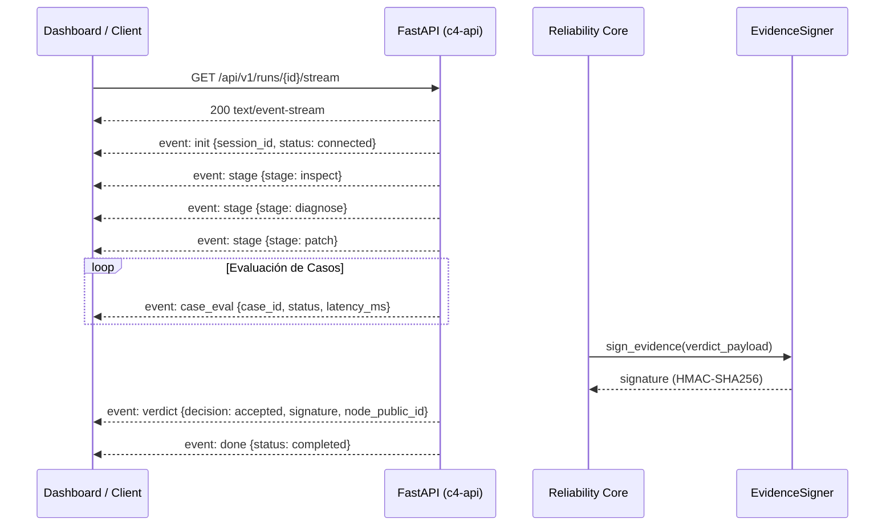

# Arquitectura de Streaming Reactivo SSE y Firmas Criptográficas

Revisión: Octubre de 2026. Responsable: DEIMER-PY.

## Visión General

C4 AI implementa un canal de comunicación unidireccional en tiempo real basado en **Server-Sent Events (SSE)** conforme a los estándares de la W3C, complementado con un esquema de **firma criptográfica y no repudio** para certificar la autenticidad e integridad de las evaluaciones emitidas.



## 1. Especificación del Canal SSE (`/api/v1/runs/{session_id}/stream`)

El endpoint opera sobre HTTP/1.1 y HTTP/2 emitiendo eventos con cabeceras de no almacenamiento en caché (`Cache-Control: no-cache`, `X-Accel-Buffering: no`).

### Catálogo de Eventos

| Evento | Carga Útil (Payload) | Descripción |
|---|---|---|
| `init` | `{"session_id": str, "status": "connected"}` | Establecimiento inicial de la conexión reactiva. |
| `stage` | `{"stage": "inspect" \| "diagnose" \| "patch", ...}` | Transición de fase del ciclo de confiabilidad en curso. |
| `case_eval` | `{"case_number": int, "case_id": str, "status": "passed" \| "failed", "latency_ms": float}` | Notificación granular e inmediata tras evaluar cada caso individual. |
| `verdict` | `{"decision": str, "candidate_score": str, "regressions": int, "signature": str, "node_public_id": str}` | Veredicto final del gate determinista sellado con firma digital. |
| `done` | `{"status": "completed"}` | Cierre ordenado del flujo de eventos. |

### Ejemplo de Consumo en TypeScript / React

```typescript
const eventSource = new EventSource("http://127.0.0.1:8000/api/v1/runs/c4_session_01/stream");

eventSource.addEventListener("case_eval", (event) => {
  const caseData = JSON.parse(event.data);
  console.log(`Caso ${caseData.case_id} evaluado:`, caseData.status);
});

eventSource.addEventListener("verdict", (event) => {
  const verdict = JSON.parse(event.data);
  console.log("Decisión final firmada:", verdict.decision, verdict.signature);
});

eventSource.addEventListener("done", () => {
  eventSource.close();
});
```

---

## 2. No Repudio y Firmas Criptográficas (`c4.tools.crypto`)

Para garantizar que un reporte de evaluación emitido por C4 AI no sea alterado ni falsificado, el motor implementa firmas basadas en HMAC-SHA256 con canonicalización estricta de payloads.

### Proceso de Firma
1. El payload JSON se canonicaliza ordenando sus claves alfabéticamente y compactando los delimitadores (`separators=(',', ':')`).
2. Se genera el código HMAC utilizando la clave secreta soberana del nodo (`C4_NODE_SECRET`).
3. El nodo expone su identificador público derivado (`node_public_id`) en `/api/v1/signature/public-id`.

### Endpoints de Verificación

- **`GET /api/v1/signature/public-id`**:
  ```json
  {
    "node_public_id": "node_7e49c2d1a3b5c7e9",
    "algorithm": "HMAC-SHA256",
    "version": "1.0.0"
  }
  ```

- **`POST /api/v1/signature/verify`**:
  ```json
  // Request
  {
    "payload": {
      "session_id": "c4_session_01",
      "decision": "accepted",
      "regressions": 0
    },
    "signature": "a1b2c3d4..."
  }
  // Response
  {
    "is_valid": true,
    "node_public_id": "node_7e49c2d1a3b5c7e9"
  }
  ```
