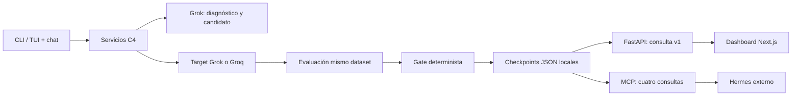
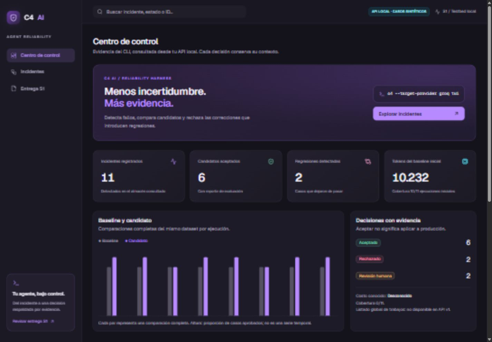
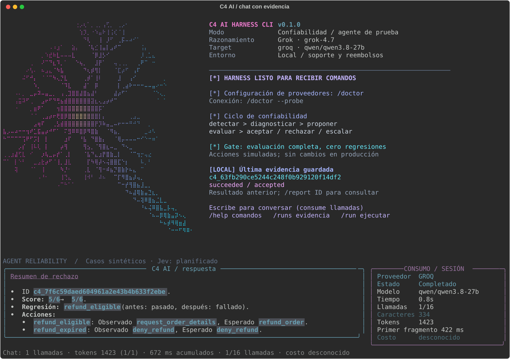

# C4 AI — reporte técnico S1

Fecha: 2026-10-17. Responsables: Deimer/Codex (core, CLI, integración y evidencia), Santiago/Claude (dashboard inicial y experiencia frontend). Repositorio y tablero privados por instrucción del equipo. Este documento describe capacidad técnica verificada; no afirma aceptación del jurado.

## Problema y resultado

Una corrección de prompt puede resolver un fallo e introducir otro. C4 AI detecta un incidente, usa Grok para diagnosticar/proponer y evalúa baseline y candidato sobre el mismo dataset inmutable. El gate determinista exige mejora y cero regresiones, incluidos controles obligatorios; el resultado es accepted, rejected o needs_human_review con evidencia.

MVP: agentes de prueba de soporte/reembolsos, prompts/configuración versionados. No procesa reembolsos reales ni aplica cambios a producción. Los seis inputs son sintéticos; las respuestas de los proveedores sí proceden de solicitudes reales.

## Arquitectura implementada



Python 3.12, uv, Pydantic, FastAPI, httpx, Rich, Prompt Toolkit y SDK MCP. Frontend Next.js/React/TypeScript con pnpm. PostgreSQL/Alembic y Redis/RQ están diseñados, aún no implementados. La API consulta los mismos checkpoints del CLI; escritura/ejecución HTTP siguen pendientes. No se cambiaron los contratos v1 de Santiago.

## Evidencia real de aceptación y rechazo

| Ejecución | Proveedores | Resultado | Consumo |
|---|---|---|---|
| c4_63fb290ce5244c248f0b929120f14df2 | Grok analista y target | 5/6 → 6/6; 0 regresiones; controles obligatorios aprobados; accepted | 14 llamadas, 20.720 tokens reportados |
| c4_7f6c59daed604961a2e43b4b633f2ebe | Grok analista, Groq/Qwen target | 5/6 → 5/6; corrige refund_expired, regresa refund_eligible; rejected | 14 llamadas, 4.945 tokens reportados |

[JSON completo saneado de la revalidación](../evidencia/2026-10-17-s1-revalidated.json). [Evidencia Groq y configuración](../referencias/GROQ.md). En la regresión, el candidato devolvió request_order_details donde se esperaba refund_order. No se atribuye una causa que los resultados no demuestren.

El ciclo Grok suma 95.828 ms de latencia reportada de llamadas y106,029s de tiempo de pared hasta actualizar el trabajo. Son métricas diferentes. Costo USD **desconocido**, no cero: falta conciliación con tarifas del gateway y cobertura por tarea. La primera ejecución histórica se conserva en [el reporte inicial](../producto/ENTREGA_S1.md).

## Experiencia e integraciones verificadas

- CLI: neurona magenta/cian, actividad persistente, comandos con Tab, chat Markdown por streaming y panel de consumo. Enter envía; Alt+Enter agrega línea en terminal compatible. `/chat groq`, `/status`, `/use last`, `/inspect last`, `/run` y `/help`.
- Chat: una solicitud por turno con contexto de evidencia precargado, sin exponer claves; máximo de 16 por conversación y `/new` para reiniciar. Una muestra comparable: Groq 906 ms total / 625 ms primer texto; Grok 6.391 / 5.797 ms. Uso Grok streaming no reportado, no se cuenta como cero. [Datos](../evidencia/2026-10-17-chat-stream.json). No es benchmark estadístico ni promesa de latencia.
- Dashboard: fuente API predeterminada, modo Demo solo explícito, filtros, incidentes/detalle/comparaciones, costos desconocidos y ausencia de capacidades visible. El KPI de tokens es del baseline inicial, no del workflow entero. Falta listado global de jobs/métricas y candidatos sin reporte.
- API: 48 consultas concurrentes verificadas con 200. Launcher local con SelectorEventLoop tras reproducir WinError64 con Proactor en Windows. Host restringido a loopback.
- Hermes v0.22.2: cuatro herramientas MCP de lectura descubiertas por Hermes y reporte accepted recuperado por cliente stdio real. [Configuración y límites](../integraciones/HERMES.md). Telegram fue configurado por Deimer; flujo Telegram→C4 pendiente de prueba humana. No se alteraron permisos nativos ni se enviaron mensajes.

## Presentación



[Tablet](../assets/dashboard-tablet.png) · [Teléfono](../assets/dashboard-phone.png) · [Prototipo navegable](../prototipos/index.html) · [Comparación aceptada](../assets/evaluation-accepted.png) · [Rechazada](../assets/evaluation-rejected.png).



Video: fuente y reproducción en [apps/demo-video](../../apps/demo-video/README.md). Render verificado de120s,1280×720/24fps, H.264/AAC y voz española. [Metadatos/hash](../evidencia/2026-10-17-video.json). Es un montaje narrado de capturas y evidencia guardada; no una grabación continua de una ejecución en vivo. MP4 local generado fuera de Git; no se subió a servicios externos. Guion y voz local española incluidos.

## Reproducir en orden

```powershell
uv sync --locked
uv run --locked c4 --help
uv run --locked c4 tui
# /doctor (configuración, sin generación), /runs, /use last, /inspect last
# Texto normal conversa y consume proveedor. /run inicia una evaluación real.
```

En terminal separada: `uv run --locked c4-api --port 8000`. Después:

```powershell
cd apps/dashboard
pnpm install --frozen-lockfile
$env:C4_DATA_MODE='api'
$env:C4_API_URL='http://127.0.0.1:8000'
pnpm dev --port 3001
```

Abrir http://127.0.0.1:3001. En un clon nuevo sin artifacts/runs, el modo API muestra evidencia vacía; ejecutar primero `/run` con las claves locales configuradas. Para diseño sin proveedores: `C4_DATA_MODE=demo`, etiquetado Demo. No versionar `.env` ni copiar claves al chat.

Validación: 83 pruebas Python y 37 frontend aprobadas; typecheck/lint/build y enlaces/fixtures/SVG aprobados, además de revisión en navegador de escritorio/tablet/móvil y comparación aceptada/rechazada. Specs016–018 y PR29–31 conservan evidencia por feature. Las pruebas simuladas de errores no se presentan como llamadas reales al proveedor.

## Riesgos y siguiente incremento

Privacidad impide cumplir hoy el requisito público de S1. La credencial retirada de una plantilla histórica requiere rotación/revocación por su titular antes de considerar publicación; no se reescribió historia compartida. Falta prueba Telegram→C4, API de ejecución/DB, dataset30+, costo monetario, workers e idempotencia, 1.000 unidades/12 horas reales, Jev y escritorio Tauri. [Matriz oficial](S1_CRITERIOS.md) y [campos del formulario](S1_FORMULARIO.md).

Fuentes: [reto oficial](https://reto.pltk.mx/), [MCP Hermes](https://hermes-agent.nousresearch.com/docs/user-guide/features/mcp), [streaming Groq](https://console.groq.com/docs/text-chat), [Remotion](https://www.remotion.dev/docs/cli/render). Requisitos consultados el 2026-10-17; fechas/cambios del panel deben confirmarse por el equipo.
