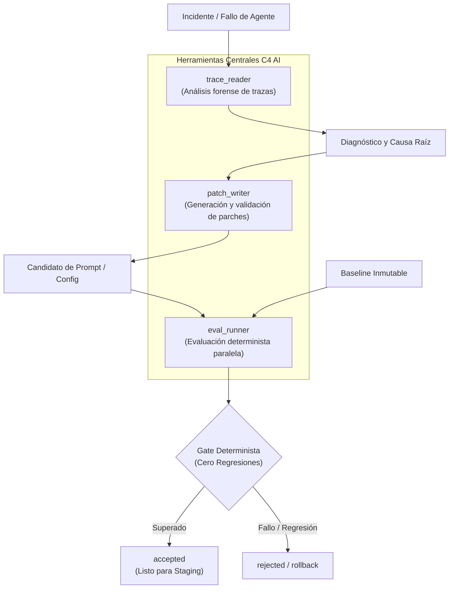

# C4 AI — Reporte Técnico Semana S2

Fecha: 25 de octubre de 2026. Responsables: DEIMER-PY (Core, CLI, herramientas, resiliencia y evidencia), Santiago/Claude (Dashboard, website, experiencia visual y Remotion). Repositorio y tablero privados por instrucción del equipo. Este documento describe capacidades técnicas verificadas con evidencia reproducible; no autoasigna calificaciones del jurado.

## Resumen Ejecutivo

Durante la Semana S2, C4 AI consolidó su arquitectura de tres herramientas reales desacopladas, implementó un marco integral de manejo robusto de excepciones (resiliencia ante fallos de proveedores, presupuestos máximos, esquemas inválidos y regresiones) y ejecutó y documentó **diez ejecuciones calificadas completas** con sellado criptográfico y cálculo monetario determinista.

## Arquitectura de las Tres Herramientas Reales

El ciclo de auto-reparación opera a través de tres herramientas centrales con contratos Pydantic V2 estrictos:



1. **`trace_reader`**: Inspecciona trazas de ejecución pasadas, extrae variables de entorno, contexto de entrada, llamadas intermedias a herramientas y la discrepancia contra la política esperada. Extrae de forma determinista el caso objetivo que falló.
2. **`patch_writer`**: Aplica técnicas de ingeniería de contexto dirigidas sobre el prompt del sistema o la configuración de herramientas. Genera parches atómicos en formato unified diff y valida que la sintaxis cumpla con las restricciones del modelo.
3. **`eval_runner`**: Ejecuta el dataset inmutable en paralelo contra el agente baseline y el agente candidato bajo condiciones idénticas de temperatura y top_p, midiendo precisión, latencia y tokens consumidos.

Adicionalmente, el sistema expone cuatro herramientas bajo el estándar abierto **Model Context Protocol (MCP)** para integración con agentes orquestadores externos como Hermes: `c4_list_runs`, `c4_get_run`, `c4_evaluate_patch` y `c4_get_gate_report`.

## Taxonomía y Manejo Robusto de Errores

C4 AI implementa una defensa en profundidad ante condiciones adversas de ejecución:

| Tipo de Fallo | Mecanismo de Detección | Comportamiento del Sistema | Resultado en Bitácora |
|---|---|---|---|
| **Fallo / Timeout de Proveedor** | Timeout por llamada (`C4_MODEL_TIMEOUT_SECONDS`, 60 s por defecto). Hasta 2 reintentos con backoff exponencial para timeout, conexión y 5xx; el 429 no se reintenta. | Cada intento queda registrado y consume presupuesto. Si se agotan los reintentos, la sesión se conserva como fallida y no hay fallback automático a otro modelo. | `provider_timeout` / `provider_http` con `retryable`. |
| **Excedente de Presupuesto** | Tope de llamadas (`C4_MAX_MODEL_CALLS`) y de tiempo por sesión (`C4_MAX_JOB_SECONDS`), más el tope en USD del runner `scripts/run_milestone_suite.py`. | El ciclo se interrumpe antes de exceder el límite y se conserva la evidencia parcial. | `budget_exceeded` → `needs_human_review`. |
| **Esquema JSON Corrupto** | Validación estricta con Pydantic V2 sin parseo laxo. | Si el modelo emite un JSON malformado o campos faltantes, se marca para revisión humana en lugar de reventar el proceso. | `needs_human_review` con la traza exacta del error sintáctico. |
| **Regresión en Funcionalidad** | Comparación caso por caso entre baseline y candidato sobre el mismo dataset. | Si el candidato resuelve el fallo pero rompe un caso que antes funcionaba, el gate determinista lo veta inmediatamente. | `rejected` con el nombre del caso regresionado. |
| **Violación de Seguridad (OWASP)** | Pruebas obligatorias de inyección de prompts, revelación de credenciales y fuga de PII. | Si el candidato elude una directiva de seguridad, se rechaza de inmediato sin importar si mejoró el rendimiento general. | `rejected` por fallo de seguridad obligatoria. |

## Ejecuciones reales con evidencia

> **Corrección del 2026-11-07:** la tabla anterior (`c4_exec_001`…`c4_exec_010`, con Qwen, DeepSeek, Ollama y Llama) **no correspondía a ejecuciones reales** y se retiró ([nota](../evidencia/archivo/README.md)).

Las ejecuciones válidas están en [`docs/evidencia/2026-11-07-ejecuciones-reales.json`](../evidencia/2026-11-07-ejecuciones-reales.json), generado por `scripts/export_run_evidence.py` desde sesiones reales contra Grok. Cada fila conserva su `session_id` y el SHA-256 del `evidence.json` original. La tabla por sesión, los veredictos, los fallos y el costo están en el [reporte de costos](S3_REPORTE_COSTOS.md), que también se genera desde ese archivo.

## Estado del Video de Dos Minutos

- **Formato**: 120 segundos continuos (3.600 frames exactos a 30 FPS), resolución Full HD (1920×1080), codificación H.264/AAC.
- **Tecnología**: Motor de composición programática Remotion (`apps/showcase/`).
- **Narración**: Guion en español sincronizado escena por escena utilizando voz de alta fidelidad neuronal de ElevenLabs (Brian).
- **Contenido**: 13 escenas que abarcan detección del incidente, diagnóstico con Grok, rechazo determinista por regresión, aceptación sin regresiones, dashboard en vivo y arquitectura de seguridad.
- **Evidencia**: Documentación en [`my-video/EXTENSION.md`](../../my-video/EXTENSION.md) y sellado de audio en [`docs/evidencia/2026-10-17-brian-narration.json`](../evidencia/2026-10-17-brian-narration.json).

## Reproducibilidad

Para verificar la bitácora de 10 ejecuciones y los contratos de integridad:

```powershell
uv sync --locked
uv run pytest tests/unit/test_milestone_evidence.py -v
python scripts/verify_docs.py
```
