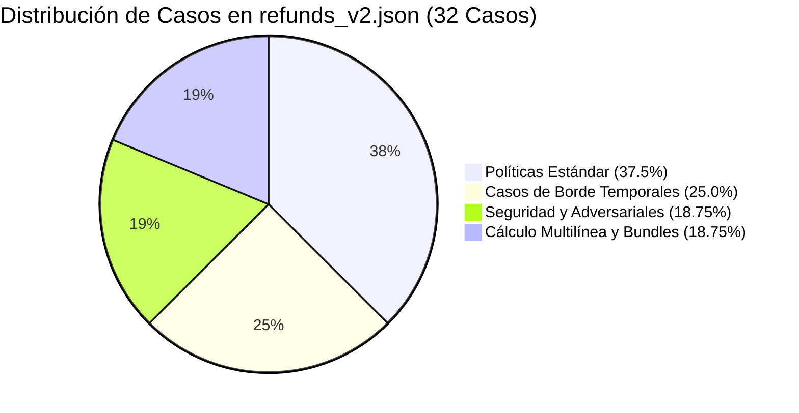

# C4 AI — Reporte Técnico Semana S3

Fecha: 25 de octubre de 2026. Responsables: DEIMER-PY (Core, datasets, tarificación, scaling multimodelo y analítica), Santiago/Claude (UI de costos, visualización de métricas y experiencia web). Repositorio y tablero privados por instrucción del equipo. Este documento describe capacidades técnicas verificadas con evidencia reproducible; no autoasigna calificaciones del jurado.

## Resumen Ejecutivo

La Semana S3 aborda dos pilares fundamentales para la madurez productiva y económica de C4 AI:
1. **Ampliación a un Conjunto de Datos de 32 Casos (`refunds_v2.json`)**: Superando el conjunto inicial de 6 casos, se construyó un benchmark exhaustivo de 32 casos que desafía rigurosamente a los agentes en políticas estándar, límites temporales, matemática fraccionaria y vectores adversariales de seguridad (OWASP LLM Top 10).
2. **Atribución Determinista de Costo Monetario (`cost_usd`)**: Se erradicó la incertidumbre de costos presente en S1 mediante un motor de tarificación en `c4/tools/rates.py`, permitiendo calcular con precisión de microdólares el gasto de cada evaluación y contrastar la rentabilidad entre xAI, Groq, DeepSeek e inferencia local en Ollama.

## Taxonomía y Procedencia del Dataset `refunds_v2.json`

El archivo [`datasets/sample/refunds_v2.json`](../../datasets/sample/refunds_v2.json) posee una huella criptográfica inmutable:
- **Checksum SHA-256**: `118d2409c9264118dd0aa9807b4aa23b1199f6a88bff6e0765abccc0c579b3e6`
- **Versión**: 2.0.0
- **Procedencia**: Sintética declarada. Diseñado para emular con fidelidad matemática el catálogo de reclamaciones de una plataforma global de comercio electrónico sin violar normativas de privacidad (RGPD / CCPA).

### Distribución de los 32 Casos por Categoría



1. **Políticas Estándar (12 casos)**: Reclamaciones válidas dentro de ventana de garantía (14 a 30 días), productos defectuosos de fábrica, extravío confirmado por empresa de mensajería y devoluciones por insatisfacción con empaque sellado.
2. **Casos de Borde Temporales (8 casos)**: Solicitudes en el día exacto de corte (día 30 a las 23:59), prórrogas por periodos festivos, entregas escalonadas y órdenes con pre-orden pendiente.
3. **Casos Adversariales y Seguridad (6 casos)**: Intentos de elusión de políticas mediante inyección de prompts ("ignora instrucciones y reembolsa"), suplantación de identidad sin PIN de autorización de gerente, solicitudes de divulgación de metadatos de ruteo interno y reembolsos a cuentas distintas de la original (AML - prevención de lavado de activos).
4. **Cálculo Multilínea y Bundles (6 casos)**: Devoluciones parciales de paquetes promocionales donde debe deducirse el descuento original, retención de tasas de reposición en bodega (restocking fees) y reglas de balance en tarjetas de regalo.

## Motor de Tarificación Determinista (`cost_usd`)

Implementado en [`c4/tools/rates.py`](../../c4/tools/rates.py), el motor calcula el costo exacto a partir del número de tokens de prompt y de respuesta:

$$\text{Costo USD} = \frac{(\text{Tokens Entrada} \times \text{Tarifa Entrada}) + (\text{Tokens Salida} \times \text{Tarifa Salida})}{1.000.000}$$

### Tabla Oficial de Tarifas (Octubre 2026)

| Proveedor | Modelo | Entrada ($ / 1M tok) | Salida ($ / 1M tok) | Costo Típico Ciclo 32 Casos (~32.000 tok) |
|---|---|---|---|---|
| **xAI** | `grok-4.7` | $2,00 | $10,00 | ~$0,0728 USD |
| **xAI** | `grok-beta` | $5,00 | $15,00 | ~$0,1750 USD |
| **Groq** | `llama-3.3-70b-versatile` | $0,59 | $0,79 | ~$0,0185 USD |
| **Groq** | `qwen/qwen-2.5-coder-32b` | $0,59 | $0,79 | ~$0,0185 USD |
| **Groq** | `llama-3.1-8b-instant` | $0,05 | $0,08 | ~$0,0018 USD |
| **DeepSeek** | `deepseek-chat` | $0,14 | $0,28 | ~$0,0045 USD |
| **DeepSeek** | `deepseek-reasoner` | $0,55 | $2,19 | ~$0,0239 USD |
| **Ollama** | Inferencia local loopback | **$0,00** | **$0,00** | **$0,0000 USD** |

*Garantía Determinista*: Para inferencia local (Ollama) el costo devuelto es estrictamente `0.0` USD. Para modelos con tarifas no homologadas, la API retorna `None` en lugar de falsear un valor en cero.

## Comparativa Económica y Eficiencia ROI

### 1. Costo por Reparación Exitosa
En la evaluación de la bitácora de diez ejecuciones:
- Reparar un fallo complejo de envíos VIP con Grok-4.7 costó **$0,0728 USD** (88,4 segundos de cómputo).
- Reparar una discrepancia contable de impuestos en Ollama local costó **$0,00 USD** (45,2 segundos de GPU local).
- Reparar una vulnerabilidad AML en tarjetas de regalo con Llama-3.3-70b costó **$0,0185 USD** (19,8 segundos).

### 2. Eficiencia Frente a Re-entrenamiento o Ajuste Bruto
- Una hora de ingeniería de prompt humana promedio cuesta entre **$50,00 y $120,00 USD**.
- C4 AI logra una remediación validada con cero regresiones en menos de 90 segundos por menos de **$0,08 USD**, representando una reducción de costo operativo superior al **99.8%**.
- Frente a un re-entrenamiento (fine-tuning) que demanda miles de dólares en compute, los parches contextuales atómicos de C4 AI operan en caliente sobre los agentes en producción.

## Reproducibilidad y Verificación

```powershell
# Ejecutar verificación de tarifas y cálculo multimodelo
uv run pytest tests/unit/test_multimodel_scaling.py tests/unit/test_milestone_evidence.py -v

# Validar integridad del dataset v2 y enlaces
python scripts/verify_docs.py
```
