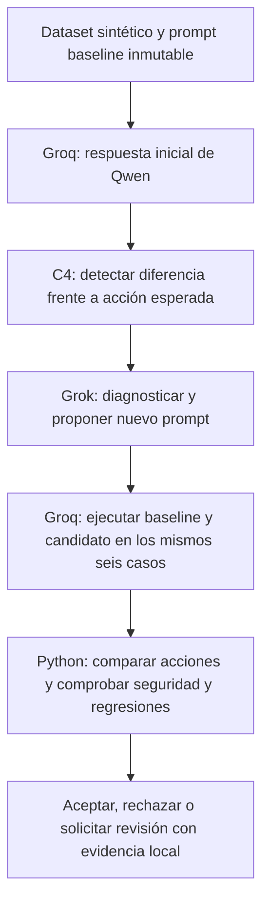

# Orden de pruebas de las integraciones
Actualizado: 2026-10-17. Responsable de CLI/core: Deimer. Dashboard: Santiago. [Spec011](../specs/011-integration-validation/spec.md).

## Flujo acordado y límites actuales
El perfil de trabajo de esta guía es **Groq/Qwen como agente evaluado y Grok como analista**. Seleccionar Groq explícitamente en cada invocación; el valor predeterminado del ejecutable continúa siendo Grok por compatibilidad.



El baseline es la versión inicial del **prompt del agente de soporte/reembolsos**, ejecutada por Qwen en Groq. Grok recibe la traza del fallo y propone una corrección; no es el modelo objetivo de este perfil. Actualmente no hay una segunda llamada a Grok que califique semánticamente todos los casos: Python compara las acciones estructuradas con el dataset y aplica el gate. No se entrena ni modifica el modelo Qwen.

## 1. Preparar dependencias y configuración
Abrir PowerShell en el clon del proyecto:

```powershell
Set-Location 'C:\Users\Usuario\OneDrive\Documentos\PROYECTO_AGENTS_C4_AI'
uv sync --locked
uv run --locked c4 --help
```

Usar el archivo local `.env` existente; no sobrescribirlo ni subirlo a Git. Comprobar en un editor que contiene las claves y estos identificadores, sin copiar secretos al chat:

| Variable | Uso |
|---|---|
| C4_GROK_API_KEY | Clave del gateway del reto, solo local |
| C4_GROK_BASE_URL | https://api.reto.pltk.mx/v1 |
| C4_GROK_MODEL | grok-4.7 |
| GROQ_API_KEY | Clave del proveedor del agente objetivo, solo local |
| C4_GROQ_BASE_URL | https://api.groq.com/openai/v1 |
| C4_GROQ_MODEL | qwen/qwen3.8-27b |

Consultar [configuración Groq verificada](../referencias/GROQ.md) si el modelo deja de estar disponible. No cambiar modelo/proveedor a mitad de una sesión guardada.

## 2. Validar configuración sin gastar solicitudes
```powershell
uv run --locked c4 --target-provider groq doctor
```

Esperado: configuración válida, Grok como razonamiento y Groq como target, sin solicitudes de generación. Esto no comprueba credenciales contra servidores.

## 3. Probar conexión real una vez
```powershell
uv run --locked c4 --target-provider groq doctor --probe
```

Esperado: ambas conexiones disponibles. Consume dos solicitudes, una por proveedor. Si falla por credenciales, modelo, cuota o red, resolver el error antes del demo. No reenviar claves por chat; un HTTP 429 requiere revisar los límites del proveedor.

## 4. Abrir y revisar la consola
```powershell
uv run --locked c4 --target-provider groq tui
```

Comprobar neurona violeta/cian, modelos correctos y prompt. Ejecutar `/help`, probar Tab y consultar `/runs`. Abrir la consola y listar sesiones no genera llamadas. La evidencia local anterior puede consultarse sin repetir pruebas; el resultado Groq de referencia es `c4_7f6c59daed604961a2e43b4b633f2ebe`, si sigue presente en este equipo.

## 5. Ejecutar una sola demo completa
Dentro de la consola:

```text
/demo
```

Esperado: ID y ruta inmediatos, etapas visibles, diagnóstico, candidato y comparación de 12 respuestas (dos versiones por seis casos). Dejar terminar sin volver a lanzarlo durante la espera. Una ejecución completa normalmente realiza **14 llamadas: 13 a Groq y una a Grok**; un fallo puede terminar antes. Se comparten límites de 16 llamadas y 600 segundos por sesión. Hay consumo en ambos proveedores; costo monetario desconocido permanece null.

Registrar el ID mostrado. El proceso no abre dashboard ni realiza reembolsos reales. La aceptación no está garantizada: se rechaza si falta mejora o aparece una regresión, incluso si mejora el incidente inicial.

## 6. Comprobar el resultado y la evidencia
En la misma consola, reemplazar ID por el identificador real:

```text
/report ID
/compare ID
/quit
```

Verificar resultados before/after, caso objetivo, controles de seguridad, regresiones, decisión y llamadas por proveedor. El archivo privado `artifacts/runs/ID/evidence.json` conserva prompts, dataset, IDs y respuestas. Las consultas no generan solicitudes. `last` también funciona, pero selecciona la sesión más reciente, que puede ser otra prueba.

Fuera de la consola, exportar JSON si se necesita:

```powershell
uv run --locked c4 --target-provider groq --json report ID
```

La [prueba real de referencia](../evidencia/2026-10-17-groq-rejected.json) completó el ciclo con 14 llamadas: baseline 5/6 y candidato 5/6; mejoró refund_expired pero rompió refund_eligible, por lo que fue rechazada. Este rechazo demuestra que el gate detectó la regresión; no equivale a un fallo de conexión.

| Código | Interpretación |
|---|---|
| 0 | Operación completada o candidato aceptado |
| 1 | Fallo técnico; consultar evidencia y error |
| 2 | Candidato rechazado; revisar comparación |
| 3 | Revisión humana sin fallo técnico |
| 130 | Cancelación con Ctrl+C; conservar evidencia parcial |

## Alternativa al paso 5: ciclo por etapas
Elegir esta alternativa **en lugar de /demo**, para inspeccionar cada integración. No repetirla sobre una sesión ya completada esperando resultados nuevos.

```powershell
uv run --locked c4 --target-provider groq start
# Copiar el ID y sustituir ID en los siguientes comandos:
uv run --locked c4 --target-provider groq patch ID
uv run --locked c4 --target-provider groq eval ID
uv run --locked c4 --target-provider groq compare ID
uv run --locked c4 --target-provider groq report ID
```

start ejecuta baseline inicial en Groq y diagnóstico/propuesta en Grok (dos llamadas). patch guarda el prompt candidato sin generación adicional. eval ejecuta los seis pares en Groq (12 llamadas). Completar las etapas dentro del límite de 600 segundos desde la creación de sesión. Para volver a probar deliberadamente, crear otra sesión.

## 7. Revisar el dashboard por separado
En otra terminal, desde la raíz del repositorio:

```powershell
Set-Location apps/dashboard
pnpm install --frozen-lockfile
pnpm dev --hostname 127.0.0.1
```

Abrir la dirección local indicada por Next.js. Revisar listado de incidentes, detalle y comparación; mantener visible la identificación de demo. **Actualmente usa fixtures:** los resultados de /demo todavía no aparecen allí. La conexión con evidencia real corresponde a C4-002/C4-006; no es un error del CLI.

## 8. Verificación automatizada y siguiente entrega
Desde la raíz:

```powershell
uv run --locked python -m unittest discover -s tests/unit -p 'test_*.py' -v
uv run --locked python scripts/verify_docs.py
```

Estas pruebas usan dobles de proveedor para cubrir errores y gate; no sustituyen el probe ni la ejecución real. La última entrega runtime verificó 52 pruebas de Python y 32 del dashboard. No hace falta provocar errores con claves reales para comprobar fallos.

Aceptar esta revisión manual cuando haya conexión a ambos proveedores, una sesión completa con decisión explicable, evidencia consultable y separación clara entre dashboard demo y CLI real. Un candidato rechazado con evaluación completa es un resultado válido; una evaluación incompleta exige revisión.

Después: Deimer continúa persistencia y API (C4-002/003); Santiago conecta frontend (C4-006) cuando se acuerde la API. Jev sigue planificado en C4-013 y requiere acceso y experimento; escritorio, sitio e instaladores siguen pendientes. [Rúbricas y responsables](RUBRICAS.md).
