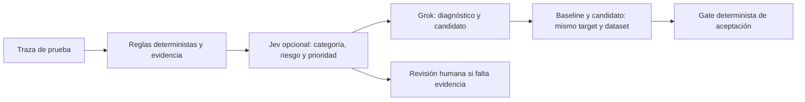

# Jev: decisiones probabilísticas en C4 AI
Estado: **planificado, no integrado**. C4-013. Fecha: 2026-10-17. Responsable: Deimer; contratos/criterios con revisión de Santiago.

Jev es un modelo externo de TypeSafe, no una fórmula inventada para C4. El [anuncio aportado por Deimer](https://typesafe.ai/blog/introducing-system-one-models-and-jev) lo presenta para decisiones estructuradas. La [introducción oficial](https://docs.typesafe.ai/introduction) describe Choice, Score y Noul. El [quickstart](https://docs.typesafe.ai/introduction/quickstart) publica POST https://api.typesafe.ai/v1/systemone, clave TYPESAFE_API_KEY y alias jev-latest. Necesitamos acceso propio; no hemos enviado solicitudes a TypeSafe.

Probabilidad y confidence no son sinónimos: la [documentación de confianza](https://docs.typesafe.ai/confidence) define confidence para Choice/Score a partir de su distribución; Noul devuelve una probabilidad. Ni un esquema correcto ni una confianza alta prueban que una decisión sea correcta en nuestros datos. Las cifras de rapidez del proveedor no son benchmarks de C4.

## Propuesta para nuestro producto

Inicialmente Jev se probará en shadow mode: anotar qué ruta recomienda sin alterar la decisión ni omitir pruebas. Preguntas propuestas: categoría del incidente (Choice), riesgo de violación de política (Noul), prioridad de investigación (Score). Usaremos trazas sintéticas y estados acotados. Guardaremos distribución, confidence donde exista, modelo real devuelto, latencia, usage y la decisión que habría tomado el flujo.

Si la evidencia del experimento lo justifica, podremos priorizar incidentes o escalar incertidumbre antes de gastar en diagnósticos extensos. Se medirá si ahorra llamadas y tiempo; añadir otro proveedor también puede aumentar latencia. Jev no generará prompts, no aceptará candidatos sin evaluación ni sustituirá Grok como razonamiento del reto.

## Rúbrica de aceptación del experimento
1. Deimer obtiene acceso y configura TYPESAFE_API_KEY en .env local. No copiar claves a chat, Git o Slack. Antes de implementar, spec/plan/tasks propios y modelo/contrato verificados.
2. Cliente con timeout/límites y validación: opciones permitidas, valores finitos entre cero y uno, distribución normalizada y respuesta completa; fallos conservan evidencia y el flujo seguro.
3. Probar misma colección versionada con y sin Jev. Separar datos usados para elegir umbrales de casos de evaluación. Registrar acierto/errores por clase, Brier/calibración cuando haya etiquetas, llamadas y latencia P50/P95, además de costos con fuente o null.
4. Elegir umbrales por riesgo a partir de esos resultados, sin hardcodear un supuesto 95 % de precisión. Revisión compartida antes de activar enrutamiento.
5. Comprobar que incertidumbre/fallo no acepta parches y que el gate completo permanece obligatorio. Evidencia reproducible y PR a develop antes de marcar Hecho.

La primera integración real depende de acceso a TypeSafe y del dataset C4-007; no requiere detener el CLI/Groq o el backend. No hay llamadas, credencial ni mejora de velocidad Jev verificadas actualmente.
