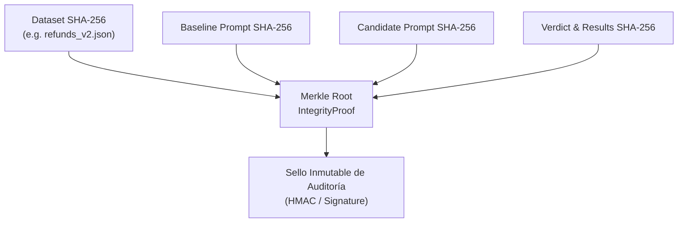

# Integridad de Datos y Cadena de Custodia Criptográfica — C4 AI

## 1. Principio de No Repudiación y Fidelidad Forense
En un entorno empresarial o SaaS, las decisiones sobre la confiabilidad de los agentes no pueden basarse en afirmaciones no comprobables o registros mutables. C4 AI implementa una **cadena de custodia criptográfica** que garantiza que:
1. La evidencia de fallo proviene de una traza real y no alterada.
2. La evaluación se ejecutó sobre un dataset inmutable verificado por su firma digital.
3. El prompt candidato y el prompt de línea base se compararon en condiciones exactamente idénticas.
4. El veredicto del gate (`accepted`, `rejected`, `needs_human_review`) no puede ser alterado con posterioridad.

---

## 2. Arquitectura de Sellado Criptográfico

Cada sesión de confiabilidad genera una estructura de prueba verificable modelada en [`c4/schemas/audit.py`](file:///C:/Users/Usuario/OneDrive/Documentos/PROYECTO_AGENTS_C4_AI/c4/schemas/audit.py):



### Cálculo de la Raíz de Integridad (Merkle Root)
El método determinista de C4 AI combina los cuatro componentes críticos de la ejecución:
```python
combined = f"{dataset_hash}:{baseline_hash}:{candidate_hash}:{verdict_hash}".encode("utf-8")
merkle_root = hashlib.sha256(combined).hexdigest()
```
Cualquier modificación posterior en el archivo de dataset, en las instrucciones del prompt o en los resultados de la evaluación invalida inmediatamente la raíz de integridad calculada.

---

## 3. Tratamiento y Anonimización de Datos Personales (PII)

De acuerdo con el Reglamento General de Protección de Datos (GDPR) y normativas internacionales de privacidad, C4 AI aplica directrices estrictas para la gestión de datos en trazas:

- **Enmascaramiento Pre-Inferencia**: Números de tarjetas de crédito/débito (PCI DSS), identificadores de cuentas bancarias, correos electrónicos corporativos privados y números de teléfono son reemplazados por tokens sintéticos antes de ser transmitidos a los modelos de diagnóstico.
- **Datasets de Muestra 100% Sintéticos**: Todos los casos de prueba incluidos en el repositorio (como [`datasets/sample/refunds.json`](file:///C:/Users/Usuario/OneDrive/Documentos/PROYECTO_AGENTS_C4_AI/datasets/sample/refunds.json) y [`datasets/sample/refunds_v2.json`](file:///C:/Users/Usuario/OneDrive/Documentos/PROYECTO_AGENTS_C4_AI/datasets/sample/refunds_v2.json)) consisten en identificadores sintéticos (`usr_synth_...`, `ord_synth_...`) generados sin datos reales de usuarios.
- **Aislamiento de Almacenamiento Local**: La evidencia persistida en disco mediante el módulo `Store` permanece bajo control soberano de la infraestructura del usuario o del tenant aislado del cliente.

---

## 4. Inmutabilidad de la Línea Base y Control de Versiones

- La línea base (*baseline prompt*) representa la configuración probada y certificada actualmente en producción.
- C4 AI impone que **la línea base es de solo lectura**. Los parches generados por el agente se materializan exclusivamente en ramas de prueba o candidatos de sesión (`patch`), impidiendo cualquier sobreescritura accidental o no autorizada.
- Solo tras obtener un veredicto `accepted` (con 0 regresiones y 100% en controles obligatorios de seguridad), el reporte de evidencia queda disponible para la integración controlada por el equipo humano.
