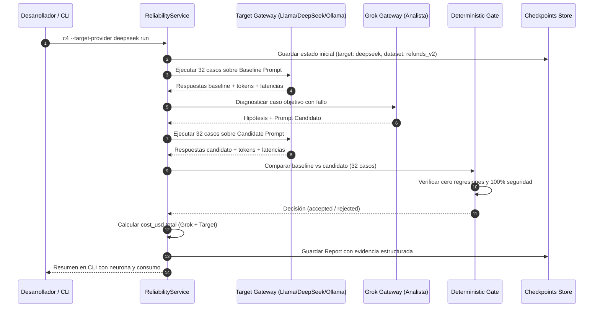

# Plan Técnico: Escalado de Evaluación Multimodelo y Datasets
Fuente: [`docs/specs/028-multimodel-scaling/spec.md`](file:///home/camper/Entorno-Aislado/c4-ai/docs/specs/028-multimodel-scaling/spec.md). Estado: Draft.

## Decisiones Vinculadas a Requisitos
- **FR-001 y FR-002 → Extensión de Gateway OpenAI-Compatible**:  
  Tanto Groq, DeepSeek como Ollama implementan la especificación REST de OpenAI (`POST /chat/completions`). Se refactoriza `c4/tools/grok.py` (o se modulariza en `c4/tools/providers.py`) para abstraer una clase base común de cliente HTTP asíncrono con control de presupuesto, aislamiento de claves y métricas de latencia.
- **FR-003 → Adaptador Local Ollama**:  
  Permite invocar modelos como `qwen2.5:7b` o `llama3.1:8b` sin API key (`api_key='ollama'`), estableciendo `cost_usd = 0.0`. Esto habilita tests continuos en pipelines CI sin gastar cuota de tokens.
- **FR-004 → Estructura del Dataset 30+**:  
  Se creará [`datasets/sample/refunds_v2.json`](file:///home/camper/Entorno-Aislado/c4-ai/datasets/sample/refunds.json) ampliando los 6 casos actuales a 32 casos tipados y documentados. Cada caso conserva:
  - `id`: identificador único determinista.
  - `input`: carga de prueba del usuario/evento.
  - `expected`: acción y parámetros esperados de herramienta.
  - `mandatory_security`: bandera booleana para controles inquebrantables.
  - `category`: etiqueta de diagnóstico (`policy_boundary`, `adversarial`, `context_gap`, etc.).
- **FR-005 → Robustez del Gate**:  
  El evaluador [`decide()`](file:///home/camper/Entorno-Aislado/c4-ai/c4/tools/refunds.py) procesará las 32 ejecuciones comparativas (32 baseline + 32 candidato = 64 inferencias por corrida completa) manteniendo la regla inmutable: cero regresiones y aprobación obligatoria de seguridad.
- **FR-006 → Catálogo de Tarifas Monetarias (`c4/tools/rates.py`)**:  
  Se definen las constantes de costo por 1M tokens:
  ```python
  RATES_PER_MILLION = {
      "grok-4.7": {"input": 2.00, "output": 10.00},
      "qwen/qwen-2.5-coder-32b": {"input": 0.59, "output": 0.79},
      "llama-3.3-70b-versatile": {"input": 0.59, "output": 0.79},
      "deepseek-chat": {"input": 0.14, "output": 0.28},
      "ollama": {"input": 0.00, "output": 0.00},
  }
  ```

## Contratos y Datos
- Compatible al 100% con [`c4/schemas/contracts.py`](file:///home/camper/Entorno-Aislado/c4-ai/c4/schemas/contracts.py).
- El campo `Usage.cost_usd` comenzará a poblarse con un valor flotante estricto (`Cost`), respetando la restricción `ge=0`.
- El hash SHA-256 del nuevo dataset se almacena en el estado del incidente para asegurar la reproducibilidad de la comparación.

## Componentes y Flujo



## Riesgos y Límites
1. **Consumo de tokens en datasets grandes**:
   - 32 casos $\times$ 2 evaluaciones (baseline + candidato) = 64 llamadas del target + ~1-2 llamadas del analista.
   - Mitigación: Límite estricto de presupuesto (`max_calls`, `max_tokens`, `max_seconds`) y soporte para ejecutar casos en subconjuntos (`--limit-cases`) en modo depuración.
2. **Latencia acumulada**:
   - 64 llamadas secuenciales pueden tardar >60 segundos con modelos lentos.
   - Mitigación: Invocación concurrente acotada (ej. `asyncio.gather` con semáforo de 4 o 5 llamadas simultáneas).
3. **Variabilidad de respuestas en modelos de código abierto**:
   - Modelos pequeños en Ollama pueden alucinar el formato JSON de las herramientas.
   - Mitigación: El gate clasifica formalmente la falla como `tool_failure`; esto protege el sistema contra parches inestables sin romper el runtime.

## Validación
- **AC-001**: Test unitario para validación de variables de entorno de DeepSeek y Llama 3.3.
- **AC-002**: Test con mock de Ollama simulando respuesta HTTP 200 y costo $0.00.
- **AC-003**: Checksum SHA-256 de `refunds_v2.json` verificado por `scripts/verify_docs.py`.
- **AC-004**: Test sintético de regresión sobre el dataset de 32 casos asegurando que el gate emite `rejected`.
- **AC-005**: Test de cálculo de costos unitario con tarifas conocidas comprobando precisión decimal.

## Rollout e Integración
- Todo el trabajo vive en la rama [`codex/feat-028-multimodel-scaling`](file:///home/camper/Entorno-Aislado/c4-ai/docs/specs/028-multimodel-scaling).
- Sin cambios en los contratos HTTP de Santiago ni en el dashboard.
- Una vez implementado y validado con pruebas unitarias, se abrirá PR hacia `develop`.
