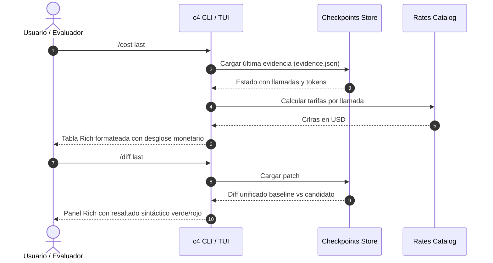

# Plan Técnico: Ergonomía de CLI e Instalación Universal
Fuente: [`docs/specs/029-cli-ergonomics-universal-install/spec.md`](spec.md). Estado: Draft.

## Decisiones Técnicas
1. **Atajos en Typer (`c4/cli.py`)**:
   - Registrar alias de comandos directamente en la aplicación Typer:
     - `@app.command('r', hidden=True)` que invoca `demo()`.
     - `@app.command('d', hidden=True)` que invoca `doctor()`.
     - `@app.command('s', hidden=True)` que invoca resumen de estado.
     - `@app.command('i', hidden=True)` que invoca `read()`.
2. **Nuevos Comandos en TUI (`c4/terminal.py`)**:
   - Ampliar `COMMANDS` con `/diff`, `/cost`, `/plan`, `/goal`.
   - Función `show_diff(state: dict)`: Extrae `state['patch']['diff']` o genera diff unificado con `rich.syntax.Syntax(..., 'diff')`.
   - Función `show_cost(state: dict)`: Renderiza `rich.table.Table` con llamadas, tokens y costos usando `c4/tools/rates.py`.
   - Bucle `/goal`: Ejecuta hasta `C4_MAX_FIX_ATTEMPTS` (por defecto 3) o hasta obtener `state['report']['decision'] == 'accepted'`.
3. **Instaladores en 1 Línea**:
   - `scripts/install.sh`: Portable a Bash en Linux/macOS.
   - `scripts/install.ps1`: Nativo de PowerShell 5.1/7+ en Windows.
   - `Dockerfile`: Multi-stage build con `ghcr.io/astral-sh/uv:latest` y `python:3.12-slim`.

## Componentes y Flujo

## Validación
- Pruebas unitarias de los nuevos comandos en `tests/unit/test_terminal.py` y `tests/unit/test_cli_aliases.py`.
- `python scripts/verify_docs.py` para asegurar integridad de enlaces.
