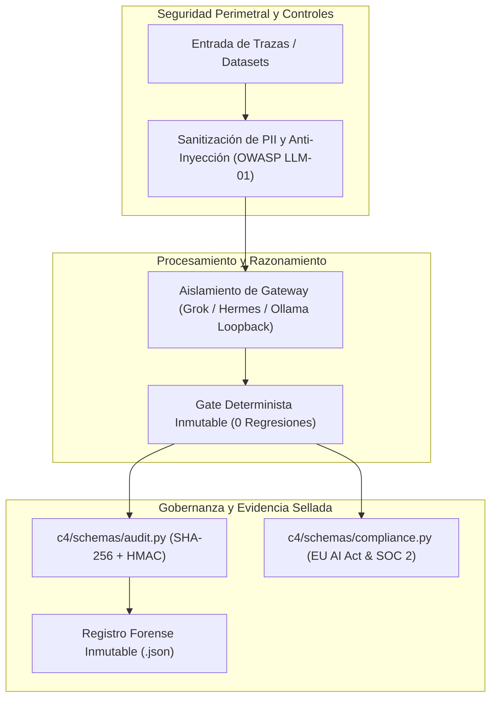

# Plan: Ciberseguridad, Integridad de Datos, Cumplimiento Legal y Auditoría SaaS
Fuente: [`spec.md`](spec.md). Responsable: DEIMER-PY.

## Arquitectura y Módulos

## Fases de Implementación
1. **Fase 1: Esquemas Pydantic de Auditoría y Cumplimiento**:
   - Crear `c4/schemas/audit.py`.
   - Crear `c4/schemas/compliance.py`.
   - Desarrollar pruebas unitarias en `tests/unit/test_compliance_schemas.py`.
2. **Fase 2: Documentación de Seguridad, Tratamiento de Datos y Marco SaaS**:
   - Redactar `docs/seguridad/COMPLIANCE_SAAS.md`.
   - Redactar `docs/seguridad/OWASP_LLM_TOP10.md`.
   - Redactar `docs/seguridad/DATA_INTEGRITY.md`.
3. **Fase 3: Artefactos Visuales SVG de Arquitectura de Seguridad**:
   - Diseñar `docs/assets/security-architecture.svg`.
   - Diseñar `docs/assets/compliance-pyramid.svg`.
4. **Fase 4: Validación y Verificación Global**:
   - Registrar la especificación en `docs/specs/README.md`.
   - Actualizar `scripts/verify_docs.py` para validar 22 SVGs y nuevos documentos.
   - Ejecutar suite de pruebas completa y verificar cero regresiones.
