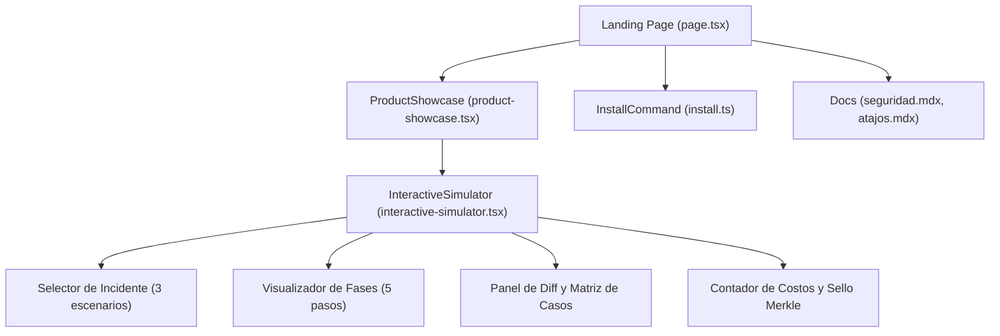

# Plan: Simulador Interactivo de Confiabilidad y Documentación Enterprise
Fuente: [`spec.md`](spec.md). Responsable: DEIMER-PY.

## Arquitectura de Componentes

## Fases de Implementación
1. **Fase 1: Datos de Simulación e InteractiveSimulator**:
   - Crear `apps/website/src/components/interactive-simulator.tsx`.
   - Implementar los 3 escenarios con sus matrices de evaluación y diffs reales.
2. **Fase 2: Integración en Showcase e Instaladores**:
   - Integrar la pestaña en `apps/website/src/components/product-showcase.tsx`.
   - Actualizar `apps/website/src/content/install.ts` con instaladores universales.
3. **Fase 3: Documentación MDX Enterprise**:
   - Crear `apps/website/src/content/docs/seguridad.mdx`.
   - Crear `apps/website/src/content/docs/atajos.mdx`.
   - Actualizar `apps/website/src/content/docs/index.ts`.
4. **Fase 4: Testing y Verificación**:
   - Crear `apps/website/src/components/interactive-simulator.test.tsx`.
   - Ejecutar suite de pruebas de Vitest (`pnpm test`).
   - Validar con `python scripts/verify_docs.py`.
