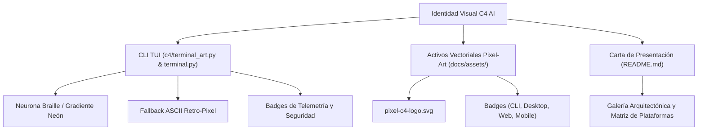

# Plan: Experiencia Cyberpunk en CLI, Logotipos Pixel-Art y README Visual Enterprise
Fuente: [`spec.md`](spec.md). Responsable: DEIMER-PY.

## Arquitectura y Componentes

## Fases de Implementación
1. **Fase 1: Rediseño del Arte Neuronal y Telemetría del CLI**:
   - Actualizar `c4/terminal_art.py` con gradientes neón y arte pixel ASCII nítido.
   - Reforzar la cabecera interactiva en `c4/terminal.py` con badges de ciberseguridad y AGY.
2. **Fase 2: Activos Vectoriales Pixel-Art e Insignias**:
   - Crear `docs/assets/pixel-c4-logo.svg`.
   - Crear directorio `docs/assets/badges/` e insignias `c4-cli-badge.svg`, `c4-desktop-badge.svg`, `c4-website-badge.svg`, `mobile-responsive-badge.svg`.
3. **Fase 3: Modernización y Enriquecimiento Visual de `README.md`**:
   - Reescribir `README.md` con estética enterprise tipo Supabase / Vercel / Kimi / Claude.
   - Incorporar la galería visual de SVGs y matriz multiplataforma.
4. **Fase 4: Testing y Verificación**:
   - Actualizar tests en `tests/unit/test_terminal.py`.
   - Validar con `python scripts/verify_docs.py` y suite completa.
