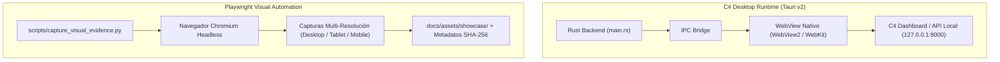

# Plan: Empaquetado Multiplataforma Desktop (Tauri v2) y Automatización Visual Playwright
Fuente: [`spec.md`](spec.md). Responsable: DEIMER-PY.

## Arquitectura de Desktop y Pipeline de Playwright

## Fases de Implementación
1. **Fase 1: Andamiaje de Escritorio Nativo (Tauri v2)**:
   - Crear `apps/desktop/package.json`.
   - Crear `apps/desktop/src-tauri/Cargo.toml`.
   - Crear `apps/desktop/src-tauri/tauri.conf.json`.
   - Crear `apps/desktop/src-tauri/src/main.rs`.
   - Crear `apps/desktop/README.md`.
2. **Fase 2: Pipeline de Automatización Visual Playwright**:
   - Crear `scripts/capture_visual_evidence.py`.
   - Crear directorio `docs/assets/showcase/`.
3. **Fase 3: Documentación de Arquitectura Desktop**:
   - Crear `docs/arquitectura/DESKTOP.md`.
4. **Fase 4: Testing, Registro y Verificación**:
   - Crear `tests/unit/test_desktop_packaging.py`.
   - Registrar spec en `docs/specs/README.md`.
   - Validar con `python scripts/verify_docs.py` y suite completa.
